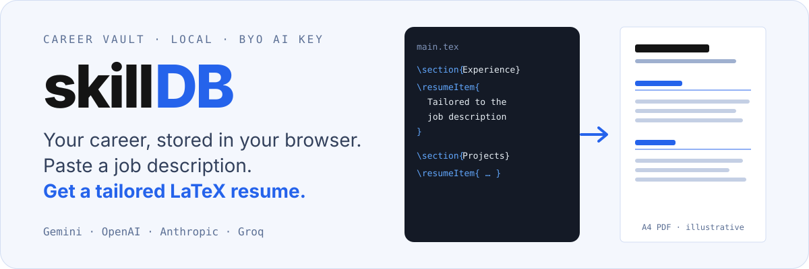
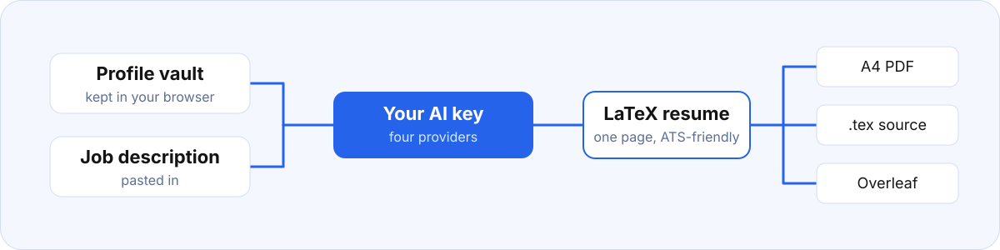

<h1 align="center">skillDB</h1>

<p align="center">
  
</p>

skillDB is a privacy-first resume and skills management platform that lives in your browser.

It acts as a personal career vault, storing all your experiences, projects, education, and skills. When you find a job you want to apply for, simply paste the job description, and skillDB uses AI (via your own local API keys) to generate a highly tailored, ATS-friendly LaTeX resume.

<p align="center">
  
</p>

## Features

- **Local Vault**: All your data is stored locally in your browser leveraging local storage. No databases, no tracking.
- **Magic Import**: Quickly populate your profile by uploading your existing PDF resume or pasting text. The AI extracts information (including preserving clickable hyperlinks from PDFs) and intelligently merges it with your existing data to ensure no duplicates.
- **AI Resume Generation**: Contextualizes your profile data against a target job description to build a custom, one-page resume in LaTeX. Choose exactly which experiences and projects to highlight.
- **True LaTeX Compilation**: Automatically compiles your tailored resume into a beautiful, professional A4 PDF. Alternatively, download the `.tex` source code or open it directly in Overleaf for further customization.
- **Multiple AI Providers**: Bring your own API key for Google Gemini, OpenAI, Anthropic, or Groq (Llama models). Switch between different models within each provider depending on your needs.
- **Interview Coach**: Chat with an AI assistant that holds your entire profile context. Practice for behavioral questions, address resume gaps, and get personalized advice tailored to your career history.
- **Multiple Resume Templates**: Choose from 6 distinct LaTeX templates (Standard, Modern, Executive, Compact, Primary Box, Red Accent) along with customizable font and style options.
- **Export & Import**: Full data portability via JSON export/import. Keep your profile securely backed up. You can also completely reset your local data at any time from Settings.
- **History Tracking**: Automatically saves the resumes you generate so you can look back at past tailored versions.
- **Light & Dark Mode**: A beautiful interface inspired by modern design principles.

## Getting Started

Run it locally (Node.js required):

```bash
npm install
npm run dev   # http://localhost:3000
```

Then, in the app:

1. Go to the Settings page and enter the API keys for the AI providers you wish to use.
2. Select your preferred AI Provider and Model in the Settings.
3. Fill out your Profile manually, or use the **Magic Import** feature to bootstrap your vault from an existing resume PDF.
4. Prepare for an application by heading to the Resume Builder. Select relevant experience, paste a job description, and generate your tailored resume!
5. Review the structural HTML preview, pick your preferred design template, and click "Download A4 PDF" to trigger the LaTeX compilation.
6. Navigate to the **Interview Coach** to practice interview questions based on your background.
